<div align="center">

# ☕ Bean & Bloom Café

### *Coffee worth waking up for.*

A modern, responsive, multi-page website for a cosy neighbourhood café. It's built with plain **HTML, CSS and JavaScript**, with no frameworks, no build tools and no backend, and it's deployed on **GitHub Pages**.

[](https://chiranshee26-source.github.io/bloom-cafe/)
[](https://github.com/chiranshee26-source/bloom-cafe/actions/workflows/pages/pages-build-deployment)


**🔗 Live website:** https://chiranshee26-source.github.io/bloom-cafe/
**📁 Repository:** https://github.com/chiranshee26-source/bloom-cafe

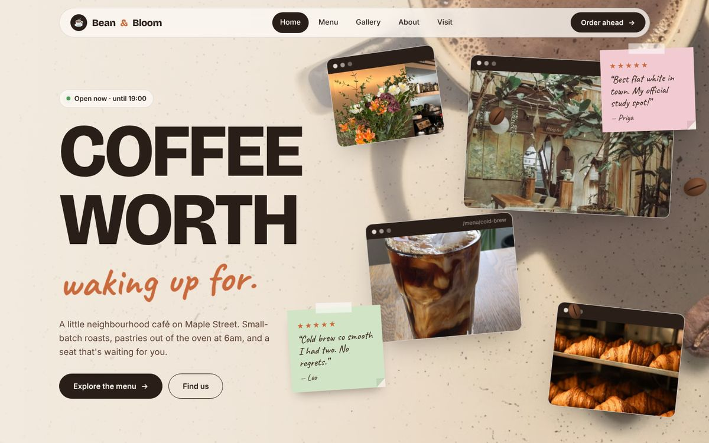

</div>

---

## 📑 Table of Contents

1. [The Idea](#-the-idea)
2. [Screenshots](#-screenshots)
3. [Features](#-features)
4. [Pages in Detail](#-pages-in-detail)
5. [Design System](#-design-system)
6. [Technology Stack](#-technology-stack)
7. [Project Structure](#-project-structure)
8. [Architecture](#-architecture)
9. [Deployment Pipeline](#-deployment-pipeline)
10. [How the Key Features Work](#-how-the-key-features-work)
11. [Responsive Design](#-responsive-design)
12. [Accessibility](#-accessibility)
13. [Performance](#-performance)
14. [Getting Started (Run Locally)](#-getting-started-run-locally)
15. [Deploying to GitHub Pages](#-deploying-to-github-pages)
16. [Customising the Website](#-customising-the-website)
17. [Testing Checklist](#-testing-checklist)
18. [Troubleshooting](#-troubleshooting)
19. [Browser Support](#-browser-support)
20. [Future Improvements](#-future-improvements)
21. [Credits & License](#-credits--license)

---

## 💡 The Idea

### What is it?
**Bean & Bloom** is a fictional café in **Katpadi, Vellore, Tamil Nadu, India**. It serves small-batch coffee roasted every week and pastries that come out of the oven at 6am. The café started life as a coffee cart outside Katpadi Junction and moved into an old flower shop, which is where the "bloom" comes from. All prices are shown in **Indian rupees (₹)**.

### Purpose
The website gives the café a warm, modern online home where visitors can:
- 🍰 **browse the menu** and build an order for pickup
- 🖼️ **see the space**, the food and the people through a photo gallery
- 📝 **read reviews** from regulars, and leave their own
- 🟢 **check whether the café is open right now**
- 📍 **find the café** and get in touch through a contact form

### Target audience
| Audience | What they need | How the site helps |
|---|---|---|
| 🎓 **University students** | A study spot with Wi-Fi and plugs | "Your third place" section, FAQ about laptops, study photos |
| 💻 **Remote workers** | A calm place to work, opening hours | Live "Open now" badge, full hours table |
| 🏡 **Local residents** | Menu, prices, what's new | Interactive menu, favourites carousel |
| 🐶 **Friends & families** | A welcoming vibe, dog-friendly | People photos, kindness wall, "Dogs welcome" FAQ |

### Design goals
- **Modern, but toned down:** muted cream and espresso tones with one warm terracotta accent.
- **Vibrant and welcoming:** hand-written touches, colourful sticky notes and real photos of people.
- **Playful:** floating "browser window" photo tabs, notes you can drag, and smooth animations.
- **Beginner-friendly code:** no frameworks, with clearly commented and organised files.

---

## 📸 Screenshots

| Home: favourites carousel | Home: "your third place" |
|---|---|
| 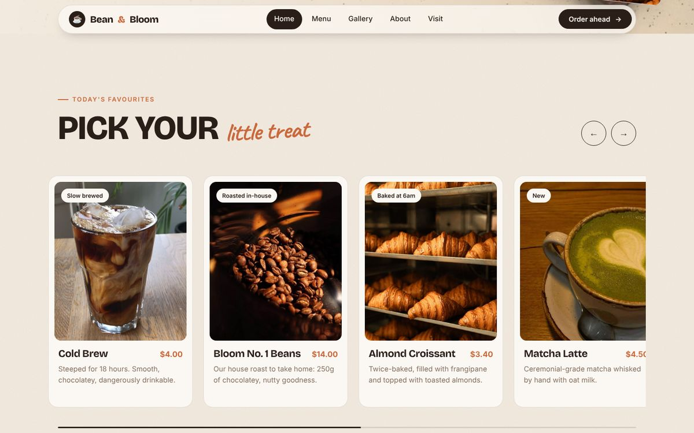 | 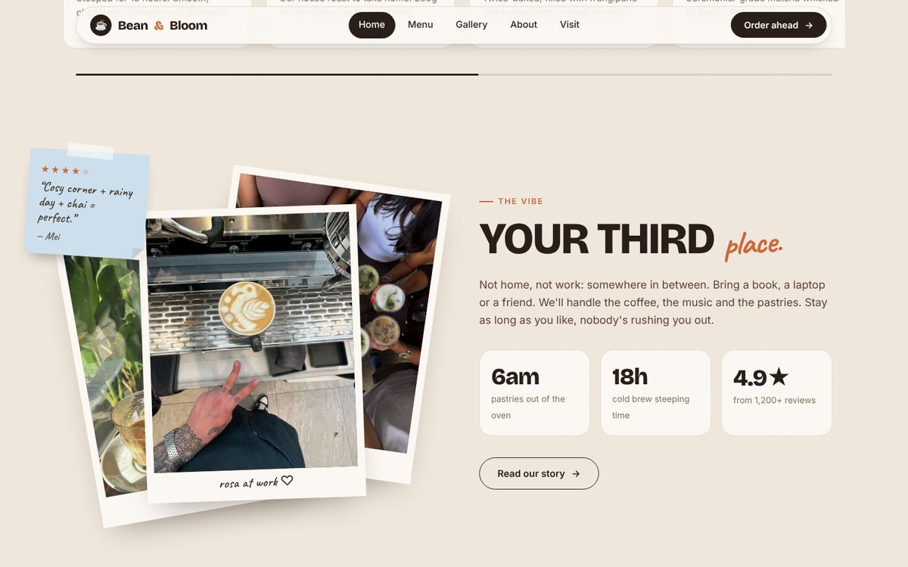 |

| Home: the kindness wall | Menu + order basket |
|---|---|
| 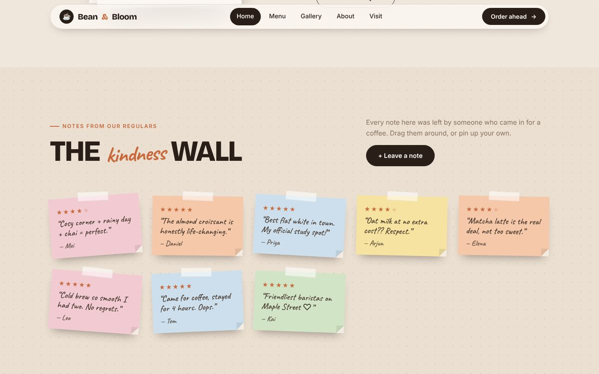 | 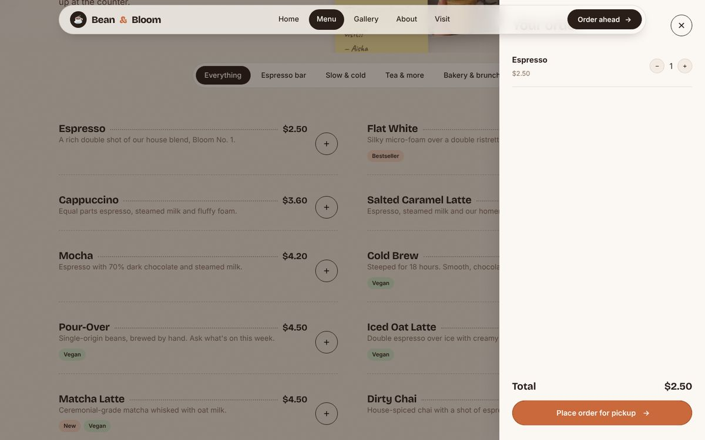 |

| Gallery | About: meet the crew |
|---|---|
| 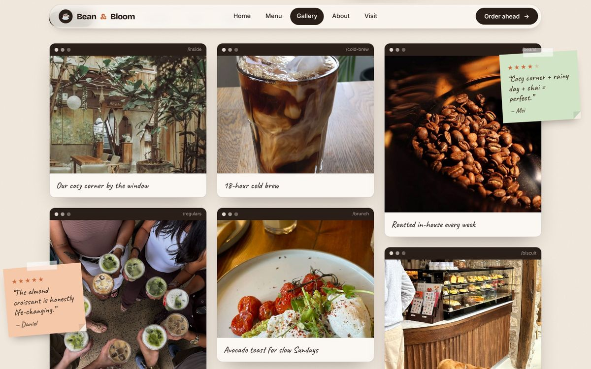 | 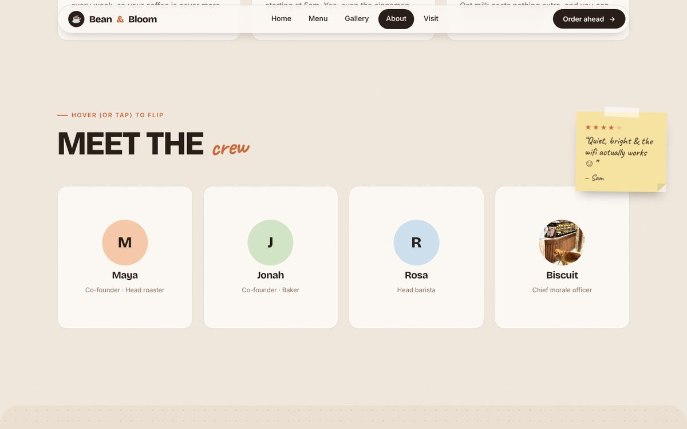 |

| Visit us | Mobile: home, menu, lightbox |
|---|---|
| 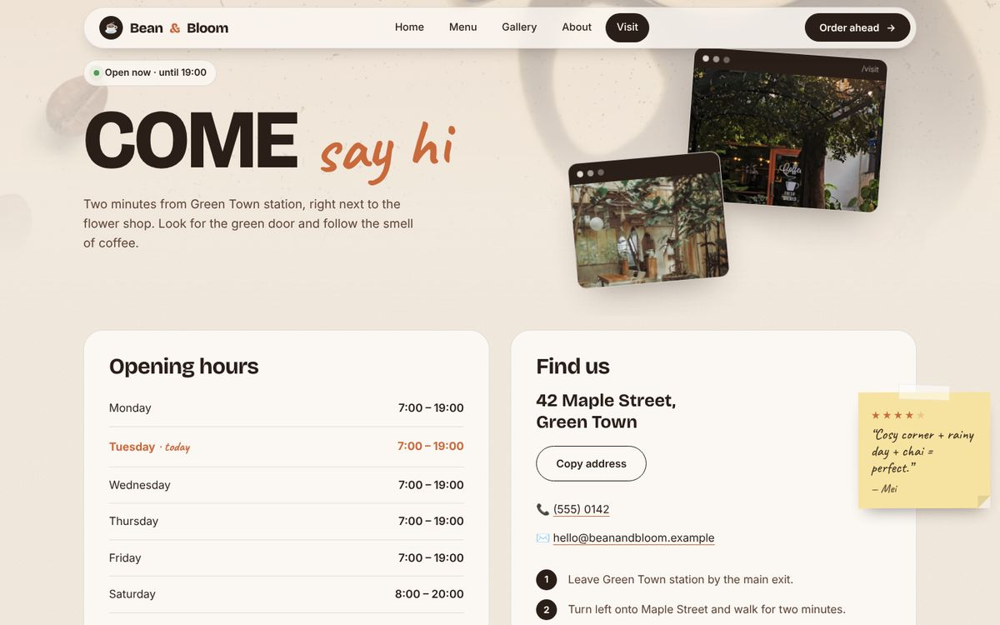 | 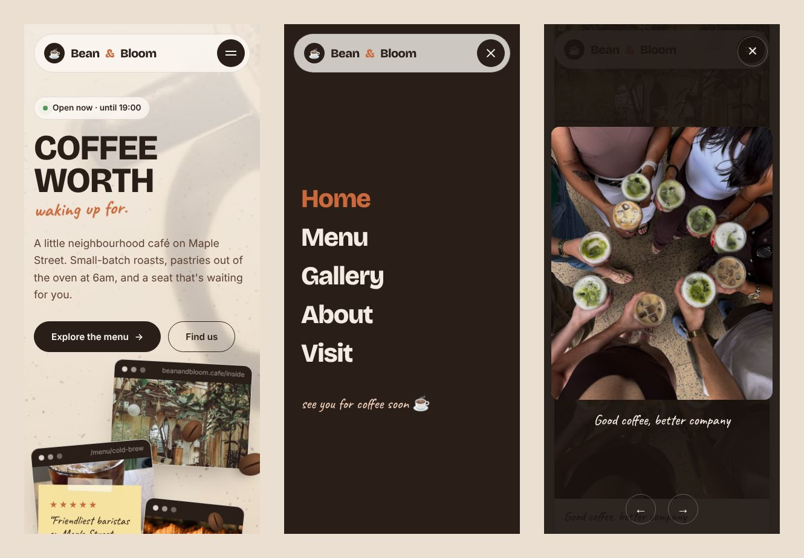 |

---

## ✨ Features

### Site-wide
| Feature | Description |
|---|---|
| 🧭 **Floating pill navigation** | A frosted-glass navbar that gets a shadow once you scroll. The current page is highlighted. |
| 📱 **Full-screen mobile menu** | On small screens the hamburger opens a full-screen menu with a **circular reveal** animation and staggered links. It closes with <kbd>Esc</kbd>. |
| 🎬 **Page transitions** | A coffee-coloured curtain with a **filling coffee cup** slides between pages. It also works with the browser's back button. |
| 📝 **Sticky-note reviews** | Notes with star ratings and handwritten reviews are scattered across every page. A random set of 12 reviews is shown on each visit. |
| ✋ **Drag-anywhere notes** | Grab any note with a mouse and it lifts off its section, so you can move it anywhere on the page as many times as you like. |
| 🔍 **Lightbox** | Click any photo marked as zoomable to see it full-screen. You can flip through with ← → keys, swipe on phones, or close with <kbd>Esc</kbd>. |
| 🟢 **Live "Open now" badge** | Works out whether the café is open from the visitor's local time, updates every minute, and highlights today's opening hours. |
| ✨ **Scroll-reveal animations** | Content fades and slides up as it enters the screen. |
| 🧾 **Toast messages** | Small pop-up confirmations for actions like placing an order or copying the address. |
| 🖼️ **Photo placeholders** | If a photo is missing, a labelled placeholder appears instead of a broken image. |
| 🦶 **Collage footer** | Tilted photo windows, a sticky note, the live badge, a full-width wordmark and a back-to-top link. |

### By page
| Page | Highlights |
|---|---|
| 🏠 **Home** (`index.html`) | Parallax hero collage · animated headline · favourites carousel · fanning polaroids · counting stats · kindness wall · visit call-to-action |
| 🍰 **Menu** (`menu.html`) | 17 items · filter tabs with a sliding pill · fly-to-basket animation · order drawer with quantities and total |
| 🖼️ **Gallery** (`gallery.html`) | 19 photos · masonry layout · 5 category filters · lightbox |
| 📖 **About** (`about.html`) | Founder story · scroll-filling timeline · values cards · flip-card team (including Biscuit the café dog 🐶) |
| 📍 **Visit** (`visit.html`) | Hours table with today highlighted · copy-address button · directions · contact form with topic chips · FAQ accordion |

---

## 📄 Pages in Detail

<details>
<summary><b>🏠 Home: <code>index.html</code></b></summary>

1. **Hero**
   - A full-screen coffee photo background with a slow "breathing" zoom.
   - The headline (*COFFEE WORTH waking up for.*) slides up line by line from behind a mask.
   - Four floating **browser-window photo tabs**, CSS coffee beans and two sticky notes **move with the mouse at different depths** (parallax).
   - A live "Open now" badge and two call-to-action buttons.
2. **Today's favourites carousel**
   - 9 cards with photo, tag, price and description.
   - Prev/next buttons (looping), click-and-drag on desktop, swipe on mobile.
   - Autoplay every 4.5s that pauses on hover, plus a progress bar.
3. **"Your third place"**
   - Three polaroid photos that **fan out** when scrolled into view.
   - Stats that **count up** (6am · 18h · 4.9★).
4. **The kindness wall**
   - A dotted pin-board of sticky-note reviews.
   - **"+ Leave a note"** opens a sticky-note-styled form with a clickable star rating, name and message.
   - New notes **drop onto the wall** with an animation and are saved in `localStorage`, so they are still there next visit. Your own notes get a "you" tag and an ✕ to remove them.
5. **Visit call-to-action:** an espresso card with the live status, address and a mini hours list where today is highlighted.

</details>

<details>
<summary><b>🍰 Menu: <code>menu.html</code></b></summary>

- The menu is **generated from a JavaScript array** (`menuItems` in `js/menu.js`), so adding a drink means adding one line.
- **Categories:** Everything · Espresso bar · Slow & cold · Tea & more · Bakery & brunch.
- A **sliding pill** animates behind the active tab, and items fade in one after another.
- Each item has a dotted price leader, a description and badges (*Bestseller*, *New*, *Vegan*).
- Pressing **"+"** sends a small dot **flying in an arc into the basket** (Web Animations API), and the basket button "bumps".
- **Order drawer:**
  - Slides in from the right, with **− / +** quantity controls and a live total.
  - "Place order for pickup" shows a confirmation. It's a demo, so nothing is actually ordered.
  - The basket is saved in `localStorage`, so it survives a page refresh.

</details>

<details>
<summary><b>🖼️ Gallery: <code>gallery.html</code></b></summary>

- **19 photos** in a responsive **masonry** layout made with CSS columns. Each photo is framed as a browser window with a handwritten caption.
- **Filters:** All photos · Coffee · The café · Food · People.
- Click any photo to open the **lightbox**. It only cycles through the photos that are currently visible.

</details>

<details>
<summary><b>📖 About: <code>about.html</code></b></summary>

- **Story:** a pull quote from the founders plus the café's history.
- **Timeline (2019 → today):** the orange line **fills as you scroll** down the page.
- **Values:** three numbered cards that turn espresso-coloured on hover.
- **Meet the crew:** **3D flip cards** (hover on desktop, tap on mobile) with a fun fact on the back. Biscuit the dog's card uses a real photo.

</details>

<details>
<summary><b>📍 Visit: <code>visit.html</code></b></summary>

- **Opening hours table:** today's row is highlighted automatically.
- **Find us:** the address, a **Copy address** button (Clipboard API), phone, email and 3-step directions.
- **Contact form:**
  - Topic chips: *Table booking / Feedback / Events / Just saying hi*.
  - Validation shows friendly inline errors.
  - The button turns into **"Sent ✓"** on success. It's frontend only, so no data is sent anywhere.
- **FAQ:** an accordion built on `<details>`/`<summary>`, with an animated **+** icon.

</details>

---

## 🎨 Design System

### Colour palette
All colours are CSS custom properties in `:root` (top of `css/style.css`).

| Token | Hex | Used for |
|---|---|---|
| `--cream` | `#f4ece2` | Page background |
| `--cream-2` | `#eadfd1` | Section backgrounds (wall, footer) |
| `--paper` | `#fbf7f2` | Cards, inputs |
| `--espresso` | `#2a1e18` | Text, dark buttons, window bars |
| `--mocha` | `#5c4033` | Body copy on light backgrounds |
| `--muted` | `#86705f` | Secondary text |
| `--accent` | `#c9693c` | Terracotta highlights, stars, links |
| `--accent-soft` | `#f0d2bd` | Badges, soft highlights |
| `--sage` | `#7d9877` | Success states |
| Sticky notes | `#f6e3a1` `#f5c8aa` `#d2e4c6` `#f2cbd2` `#cddfec` | Yellow, peach, mint, pink, blue |

### Typography
| Role | Font | Why |
|---|---|---|
| Headings | **Bricolage Grotesque** (700–800) | Bold, modern, slightly quirky. Used uppercase for big statements |
| Body | **Inter** (400–700) | Very readable at small sizes |
| Handwritten | **Caveat** (500–700) | Sticky notes, captions and accents like *little treat* |

### Signature components
| Component | Description |
|---|---|
| **Photo window** | A photo framed like a mini browser tab (three dots and a URL in a dark bar), tilted and floating |
| **Sticky note** | A coloured note with a strip of "tape", a folded corner, a random tilt, stars and a handwritten review |
| **Polaroid** | A white-bordered photo with a handwritten caption |
| **Pill buttons** | Rounded buttons whose colour **fills up from the bottom** on hover |
| **Paper grain** | A subtle SVG noise texture over the whole site |

### Motion principles
- One shared easing curve: `cubic-bezier(0.22, 1, 0.36, 1)`, a soft "ease-out-expo".
- Animations are **purposeful**: they show where things come from (the basket dot), what changed (the tab pill) or add personality (notes, steam, the curtain).
- All motion is disabled for visitors who turn on **Reduce motion** in their operating system (`prefers-reduced-motion`).

---

## 🧰 Technology Stack

| Layer | Technology | Used for |
|---|---|---|
| Structure | **HTML5** | Semantic markup: `header`, `nav`, `main`, `section`, `article`, `figure`, `footer`, `details` |
| Styling | **CSS3** | Custom properties, Flexbox, Grid, multi-column masonry, `clip-path`, `backdrop-filter`, 3D transforms, keyframe animations, media queries, SVG masks |
| Behaviour | **Vanilla JavaScript (ES6+)** | DOM manipulation, event delegation, `IntersectionObserver`, Web Animations API, Pointer Events, `localStorage`, Clipboard API, `requestAnimationFrame` |
| Fonts | **Google Fonts** | Bricolage Grotesque, Inter, Caveat |
| Graphics | **Inline SVG** | Favicon, footer wordmark, paper-grain texture |
| Version control | **Git + GitHub** | Source code and history |
| Hosting / CI | **GitHub Pages** + **GitHub Actions** | Automatic build and deploy on every push to `main` |

> **No frameworks, no npm, no build step.** Every file in the repository is served to the browser exactly as written.

---

## 📂 Project Structure

```
bloom-cafe/
│
├── index.html            # 🏠 Home page
├── menu.html             # 🍰 Menu + order basket
├── gallery.html          # 🖼️ Photo gallery + lightbox
├── about.html            # 📖 Story, timeline, values, team
├── visit.html            # 📍 Hours, directions, contact form, FAQ
│
├── css/
│   └── style.css         # All styles, in 14 numbered sections (see below)
│
├── js/
│   ├── main.js           # Shared by every page (nav, transitions, notes, lightbox…)
│   ├── home.js           # Home only: parallax, carousel, counters, notes wall
│   ├── menu.js           # Menu only: menu data, filter tabs, basket
│   ├── gallery.js        # Gallery only: category filters
│   ├── about.js          # About only: scroll timeline, flip cards
│   └── visit.js          # Visit only: copy address, topic chips, contact form
│
├── images/               # 20 photos (see images/README.md for the full list)
│   ├── hero.jpg          # Home background
│   ├── cafe-1…3.jpg      # Café interior
│   ├── coffee-1…4.jpg    # Drinks
│   ├── pastry-1…2.jpg    # Bakery
│   ├── storefront.jpg, flowers.jpg, roasting.jpg, tea.jpg
│   ├── dessert.jpg, breakfast.jpg
│   ├── people-1…2.jpg, barista.jpg, dog.jpg
│   └── README.md         # Which photo goes where
│
├── assets/
│   └── favicon.svg       # Coffee-cup browser icon
│
├── docs/
│   └── screenshots/      # Images used in this README
│
├── .nojekyll             # Tells GitHub Pages to serve files as-is
└── README.md             # You are here 👋
```

### How `css/style.css` is organised
| # | Section | # | Section |
|---|---|---|---|
| 1 | Design tokens (colours, fonts, shadows) | 8 | Sticky notes |
| 2 | Base & typography | 9 | Home page |
| 3 | Buttons, chips, status badge, toast | 10 | Menu page |
| 4 | Page curtain (transitions) | 11 | Gallery page |
| 5 | Navigation & mobile menu | 12 | About page |
| 6 | Photo windows & lightbox | 13 | Visit page |
| 7 | Shared sections, page heroes, footer | 14 | Responsive breakpoints & reduced motion |

---

## 🧱 Architecture

The site is a **static multi-page website**. Each page is its own HTML file, and they all share one stylesheet and one core script (`main.js`). Each page also loads one small script of its own.

### Page and script map

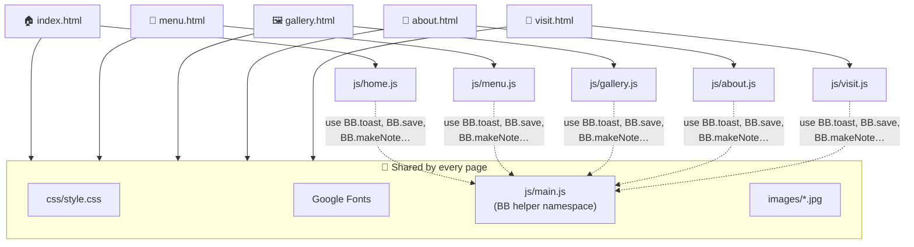

### What happens when a page loads

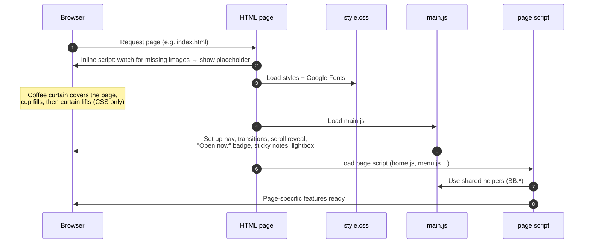

### The shared `BB` namespace (`js/main.js`)
`main.js` creates one global object called `BB` (for **B**ean & **B**loom), so the page scripts can reuse its helpers instead of duplicating code:

| Helper | What it does |
|---|---|
| `BB.load(key, fallback)` / `BB.save(key, value)` | Read and write `localStorage` safely. Falls back gracefully in private windows |
| `BB.toast(message)` | Shows a pop-up message at the bottom of the screen |
| `BB.stars(rating)` | Builds a ★★★★☆ string |
| `BB.escape(text)` | Escapes user text before it's put on the page, which prevents HTML injection |
| `BB.reviews` | The list of 12 customer reviews used on sticky notes |
| `BB.makeNote(note)` | Creates a sticky-note element (random colour and tilt, draggable) |
| `BB.hours` | Opening hours by weekday, used by the "Open now" badge |
| `BB.observeReveal()` | Registers elements for scroll-reveal animations |

### Data & state
There is **no database and no server**. All data lives in the code, and anything a visitor creates is stored in their own browser:

| Data | Where it lives | Persists? |
|---|---|---|
| Menu items | `menuItems` array in `js/menu.js` | In code |
| Reviews on notes | `BB.reviews` in `js/main.js` | In code |
| Opening hours | `BB.hours` in `js/main.js` (and the hours tables in HTML) | In code |
| Visitor's own notes | `localStorage["bb-notes"]` | ✅ Per browser |
| Order basket | `localStorage["bb-basket"]` | ✅ Per browser |
| Contact form messages | Not stored, only validated | ❌ Demo only |

---

## 🚀 Deployment Pipeline

The site is deployed with **GitHub Pages** using the **"Deploy from a branch"** method. Every push to `main` automatically triggers GitHub's built-in **`pages-build-deployment`** workflow (GitHub Actions), which publishes the new version within a minute or two.

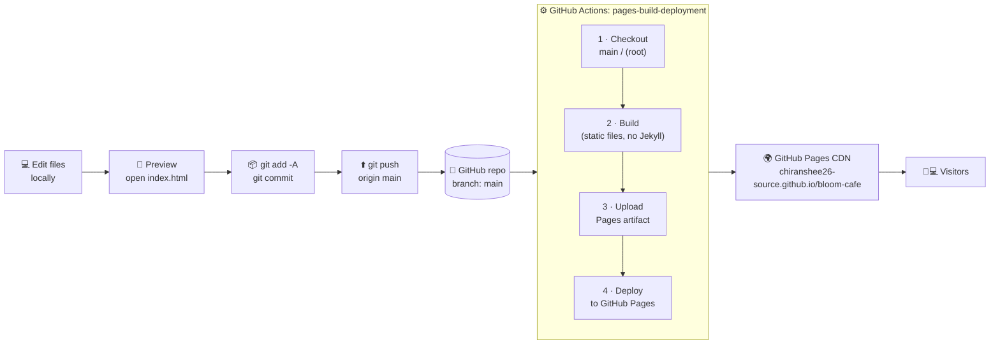

| Stage | What happens | Where to see it |
|---|---|---|
| **1. Develop** | Edit HTML/CSS/JS and photos, then preview by opening `index.html` | Your computer |
| **2. Commit** | `git add -A` and `git commit -m "…"` save a snapshot | Your computer |
| **3. Push** | `git push` uploads commits to the `main` branch | Repo → **Commits** |
| **4. Build** | GitHub Actions checks out `main` and packages the files. `.nojekyll` means files are served exactly as they are | Repo → **Actions** → *pages build and deployment* |
| **5. Deploy** | The package is published to GitHub's global CDN over HTTPS | Repo → **Settings → Pages** |
| **6. Live** | Visitors get the new version (press <kbd>Ctrl</kbd>+<kbd>F5</kbd> to skip the old cached copy) | https://chiranshee26-source.github.io/bloom-cafe/ |

The **pages-build-deployment** badge at the top of this README shows the status of the latest deployment: green means live.

---

## 🔧 How the Key Features Work

<details>
<summary><b>🎬 Page transition curtain</b></summary>

- Every page starts with a full-screen espresso `.curtain` that **CSS** animates upwards (`curtainUp`), so it works even before JavaScript loads.
- When you click a link to another page, `main.js` cancels the normal navigation and adds `.closing`, which slides the curtain down. After 500ms it goes to the new page.
- Links opened in a new tab (<kbd>Ctrl</kbd>/<kbd>Cmd</kbd>-click) and same-page `#anchors` are left alone.
- A `pageshow` listener re-opens the curtain when you come back using the browser's **Back** button.

</details>

<details>
<summary><b>🖼️ Parallax hero (home)</b></summary>

- Each floating element sits in a `.layer` with a `data-depth` value (18–100).
- On `mousemove`, `home.js` converts the mouse position to a range of −0.5 to 0.5 and moves each layer by `position × depth` pixels **in the opposite direction**. Deeper layers move more, which creates the 3D feel.
- Only runs on devices with a real mouse (`(hover: hover) and (pointer: fine)`).
- The float animation uses the separate CSS `translate` property, so it doesn't fight with the parallax `transform`.

</details>

<details>
<summary><b>✋ Drag-anywhere sticky notes</b></summary>

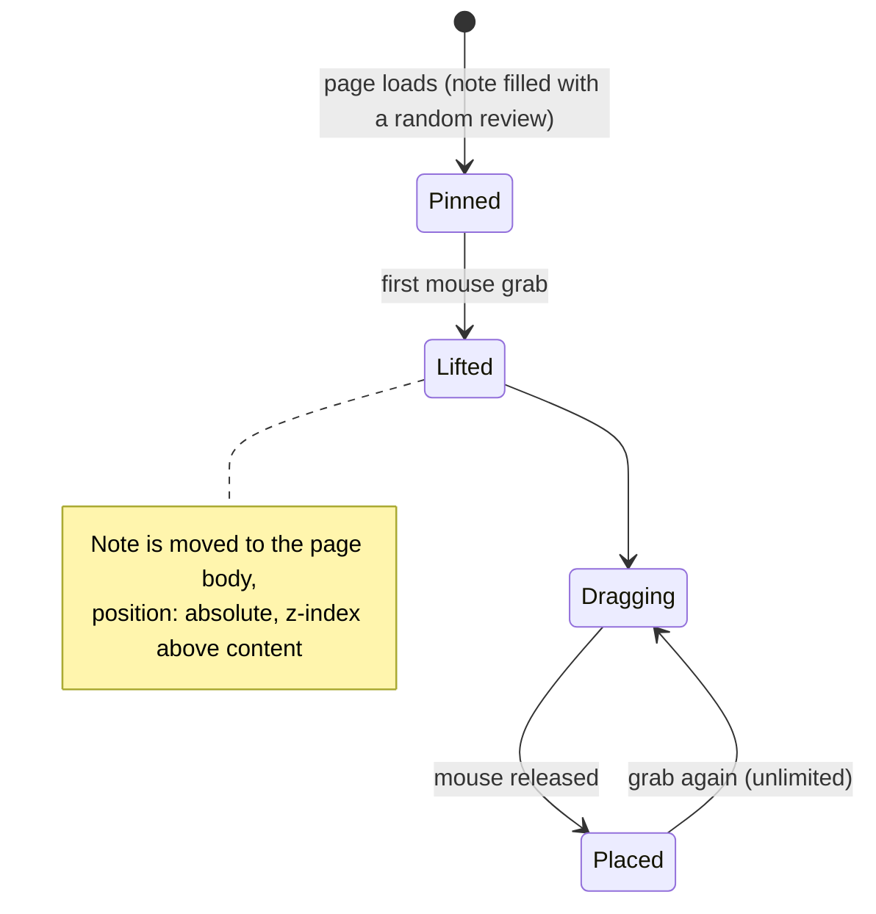

- **First grab:** the note's size and position are measured, then it's moved out of its section into `<body>`. That's why it can travel anywhere on the page, even into the footer.
- While dragging, `left`/`top` follow the pointer (`pointermove`) and are **clamped** so the note can't leave the page.
- `setPointerCapture` keeps the drag smooth even if the mouse moves fast.
- On touch screens dragging is turned off on purpose, so swiping still scrolls the page.

</details>

<details>
<summary><b>📌 Kindness wall (leave a note)</b></summary>

1. The modal form validates the name (2+ characters) and message (5+ characters), and lets you pick 1–5 stars.
2. The note is saved as `{ id, name, text, rating }` in the `localStorage` key `bb-notes`.
3. `BB.makeNote()` builds it with a random colour and tilt. It drops onto the wall with the `dropIn` animation and gets a "you" tag plus an ✕ remove button.
4. On the next visit, saved notes are read back and pinned automatically.
5. All user text goes through `BB.escape()` before being shown, so nobody can inject HTML.

</details>

<details>
<summary><b>🧺 Menu basket & fly-to-basket animation</b></summary>

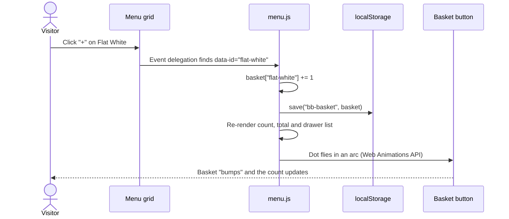

- One click listener on the whole grid handles every "+" button (**event delegation**), so it still works after filters re-render the items.
- The flying dot starts at the button's position and ends at the basket's position (`getBoundingClientRect`). It's animated through a raised midpoint to make an arc.

</details>

<details>
<summary><b>🎠 Favourites carousel</b></summary>

- Built on native horizontal scrolling with **CSS scroll-snap**, so touch swiping works with no extra code.
- The arrows call `scrollBy()` by one card width and loop around at the ends.
- Click-and-drag with a mouse updates `scrollLeft` as you move.
- The progress bar width = visible fraction + scrolled fraction.
- Autoplay (4.5s) pauses on hover and stops once you touch it.

</details>

<details>
<summary><b>👀 Scroll reveal, counters, polaroids & timeline</b></summary>

- **Reveal:** elements with `data-reveal` start transparent and shifted down. One shared `IntersectionObserver` adds `.in-view` when 15% is visible, and CSS handles the animation. `--delay` staggers them.
- **Counters:** a second observer animates each `data-count` number with `requestAnimationFrame` and an ease-out curve. It supports decimals (`4.9`) and suffixes (`am`, `h`, `★`).
- **Polaroids:** `data-inview` adds `.in-view`, which moves the stacked photos into a fan.
- **Timeline:** on scroll, `about.js` works out how far the timeline has passed 60% of the screen height, and sets the orange line's height to match.

</details>

<details>
<summary><b>🟢 "Open now" badge</b></summary>

- `BB.hours` stores `[open, close]` for each weekday (0 = Sunday).
- The badge compares the visitor's **local time** with today's hours and shows *"Open now · until 19:00"* or *"Closed · opens 7:00"*. A pulsing green or red dot shows which.
- Any element with `data-day="1,2,3"` is highlighted on those weekdays (the hours tables).
- It re-checks every 60 seconds.

</details>

<details>
<summary><b>🖼️ Missing-photo placeholders</b></summary>

- A tiny inline script in each page's `<head>` listens for image `error` events and adds `.img-missing` to any photo that fails to load.
- Each photo sits inside a `.photo` box with a warm gradient background and a `data-label` (e.g. `images/cafe-1.jpg`). When the image is hidden, the label shows, so it's obvious which file is missing.

</details>

---

## 📱 Responsive Design

The layout is **desktop-first** with three breakpoints. It was tested at 1440px (desktop), 900px (tablet) and 390px (phone), with no horizontal scrolling at any size.

| Breakpoint | Layout changes |
|---|---|
| **> 1100px** (desktop) | Full navbar · hero collage beside the headline · 3–4 column grids · all floating notes visible |
| **≤ 1100px** (small laptop) | Some floating notes are hidden to avoid clutter · team grid becomes 2 columns |
| **≤ 900px** (tablet) | Hamburger and full-screen menu · hero collage moves **below** the headline · single-column layouts (vibe, story, visit, footer) · page-hero photo windows hidden · floating notes sit inside the page flow |
| **≤ 600px** (phone) | Bigger tap targets · wall shows 2 notes per row · stats stack · team becomes 1 column · carousel cards take 78% of the width · lightbox arrows move to the bottom · footer links in 2 columns |

Other responsive techniques:
- **Fluid typography** with `clamp()`, e.g. the hero title is `clamp(3.6rem, 10.5vw, 9.5rem)`.
- **Fluid container:** `width: min(1200px, 100% - 40px)`.
- **`100svh`** for the hero, so it fits correctly on mobile browsers whose toolbars show and hide.
- **SVG wordmark** in the footer uses `textLength`, so it always fits the width exactly.
- `overflow-x: clip` on `main` and `footer` stops tilted decorations from causing sideways scrolling.

---

## ♿ Accessibility

- **Semantic HTML:** landmarks (`header`, `nav`, `main`, `footer`), heading order, `figure`/`figcaption`, `details`/`summary`.
- **Alt text** on all meaningful photos. Decorative ones use `alt=""` and/or `aria-hidden="true"`.
- **ARIA:**
  - `aria-expanded` and `aria-controls` on the menu button, and `aria-current="page"` on the active link.
  - `role="dialog"` and `aria-modal` on the lightbox and note form.
  - `role="status"` on toasts, plus `aria-label`s on icon-only buttons.
- **Keyboard support:**
  - All controls are real `<button>`s and links.
  - Photos can be opened with <kbd>Enter</kbd>. <kbd>Esc</kbd> closes the menu, lightbox, modal and drawer, and <kbd>←</kbd>/<kbd>→</kbd> move through the lightbox.
  - Team cards flip on keyboard focus.
- **Reduced motion:** every animation and transition is effectively switched off when the operating system's *Reduce motion* setting is on.
- **Colour contrast:** dark espresso text on cream backgrounds.

---

## ⚡ Performance

- **Zero dependencies:** no frameworks or libraries to download. All the JavaScript together is about 30 KB, unminified.
- **Optimised photos:** about 50–200 KB each, about 2.4 MB in total for 20 photos.
- **Lazy loading** (`loading="lazy"`) for gallery and footer images.
- **Efficient animations:** only `transform` and `opacity` are animated where possible, and `IntersectionObserver` is used instead of scroll listeners for reveals.
- **Passive scroll listeners** and **event delegation** (one listener for all menu buttons).
- **Font loading** with `display=swap` and `preconnect` to Google Fonts.

---

## 🏁 Getting Started (Run Locally)

### Prerequisites
- Any modern browser (Chrome, Edge, Firefox or Safari).
- *(Optional)* [Git](https://git-scm.com/downloads) to clone the repository.
- *(Optional)* [VS Code](https://code.visualstudio.com/) with the **Live Server** extension.

### Steps
1. **Clone the repository**
   ```bash
   git clone https://github.com/chiranshee26-source/bloom-cafe.git
   cd bloom-cafe
   ```
   …or click **Code → Download ZIP** on GitHub and unzip it.

2. **Open the site.** Choose one:

   | Option | How |
   |---|---|
   | Simplest | Double-click `index.html` |
   | VS Code | Right-click `index.html` → **Open with Live Server** |
   | Python | `python -m http.server 8000`, then open http://localhost:8000 |

No installation, `npm install` or build step is needed.

---

## 🌐 Deploying to GitHub Pages

### First-time setup
1. Push the code to a **public** GitHub repository.
2. In the repository, open **Settings → Pages**.
3. Under **Build and deployment**:
   - **Source:** `Deploy from a branch`
   - **Branch:** `main`, folder `/ (root)`, then click **Save**.
4. Open the **Actions** tab and wait for **pages build and deployment** to show a ✅ green tick (about 1–2 minutes).
5. The site is live at `https://<username>.github.io/<repository-name>/`.

### Publishing updates (Windows PowerShell)
```powershell
cd "C:\path\to\bloom-cafe"
git add -A
git commit -m "Describe what you changed"
git push
```
GitHub Pages re-deploys automatically. Refresh the live site with <kbd>Ctrl</kbd>+<kbd>F5</kbd>.

### Checking that the site is deployed
- ✅ **Settings → Pages** shows *"Your site is live at …"*
- ✅ **Actions** tab: the latest *pages build and deployment* run is green
- ✅ The badge at the top of this README is green
- ✅ The live URL opens the new version (try a private/incognito window to skip the cache)

---

## 🧩 Customising the Website

| I want to… | Edit this | Example |
|---|---|---|
| Add or change a **menu item** | `menuItems` in `js/menu.js` | `{ id: "latte", name: "Latte", price: 210, category: "espresso", desc: "…", badges: ["New"] }` (price in ₹, shown as "₹210") |
| Change the **reviews** on sticky notes | `BB.reviews` in `js/main.js` | `{ name: "Alex", rating: 5, text: "Lovely!" }` |
| Change **opening hours** | `BB.hours` in `js/main.js` **and** the hours tables in `index.html` / `visit.html` | `[7, 19]` = 7:00 to 19:00 |
| Change the **colours** | Design tokens in `:root` at the top of `css/style.css` | `--accent: #c9693c;` |
| Swap a **photo** | Replace the file in `images/` and keep the same name | `images/hero.jpg` |
| Add a **gallery photo** | Copy one `<figure class="window" …>` block in `gallery.html` | Set `data-cat` to `coffee`, `cafe`, `food` or `people` |
| Add a **sticky note** anywhere | Add `<div class="note float" data-note></div>` inside any section | It's filled with a random review automatically |

> 📷 Photo names must be **lowercase** and end in **`.jpg`**. GitHub Pages is case-sensitive, so `Hero.JPG` will not load. See [`images/README.md`](images/README.md) for every photo and where it appears.

---

## ✅ Testing Checklist

The site was tested in Chromium at desktop (1440×900) and mobile (390×844) sizes, with no console errors and no horizontal overflow.

| Area | Test | Result |
|---|---|---|
| Navigation | Desktop links, active page, mobile menu opens/closes, <kbd>Esc</kbd> closes | ✅ |
| Transitions | Curtain between pages, back button re-opens page | ✅ |
| Sticky notes | Random reviews, drag 3+ times, move across sections | ✅ |
| Kindness wall | Validation errors, note added, saved after reload, removable | ✅ |
| Carousel | Arrows loop, drag, swipe, progress bar | ✅ |
| Menu | Filters (5 tabs), add to basket, quantities, total, place order | ✅ |
| Gallery | 5 filters (19 / 6 / 5 / 4 / 4 photos), lightbox next/prev/close | ✅ |
| About | Timeline fills on scroll, team cards flip | ✅ |
| Visit | Today highlighted, copy address, form validation and success | ✅ |
| Responsive | 1440px, 900px, 390px with no sideways scroll | ✅ |

---

## 🧯 Troubleshooting

| Problem | Cause | Fix |
|---|---|---|
| A photo shows a brown box with a file name | The file is missing or named differently | Check the exact name in `images/` (lowercase, `.jpg`, e.g. `dessert.jpg`, not `desert.jpg`) |
| Photos work locally but not on the live site | Capital letters or `.jpeg` / `.JPG` | Rename to lowercase `.jpg`, then commit and push |
| Live site still shows the old version | Browser cache | Press <kbd>Ctrl</kbd>+<kbd>F5</kbd> or open an incognito window |
| Live site shows **404** | Pages not enabled, or deployment still running | Check **Settings → Pages** and the **Actions** tab |
| `git push` is **rejected** | GitHub has commits you don't have locally (e.g. an edit made on github.com) | `git pull --no-rebase`, then `git push` |
| Sticky notes won't drag on a phone | On purpose: touch is kept for scrolling | Use a mouse or trackpad |
| Kindness-wall notes disappeared | They are stored per browser (`localStorage`) | Clearing site data or switching browsers removes them |

---

## 🌍 Browser Support

| Browser | Supported |
|---|---|
| Chrome / Edge (latest) | ✅ |
| Firefox (latest) | ✅ |
| Safari 15.4+ (macOS & iOS) | ✅ |
| Internet Explorer | ❌ Not supported |

The site uses modern CSS such as the individual `translate`/`rotate` properties, `overflow: clip`, `svh` units and `backdrop-filter`, all supported by every current browser.

---

## 🔮 Future Improvements

- 🛒 Connect the order basket to a real ordering or payment service.
- ✉️ Send contact form messages with a form service (e.g. Formspree or EmailJS).
- 🗺️ Embed an interactive map on the Visit page.
- 🌙 Add a dark mode using the existing colour tokens.
- 🌐 Add multi-language support.
- 🖼️ Serve photos as WebP/AVIF with `srcset` for even faster loading.
- 🧪 Add automated end-to-end tests with Playwright.

---

## 📜 Credits & License

- **Design & development:** [Chiranshee](https://github.com/chiranshee26-source)
- **Fonts:** [Bricolage Grotesque](https://fonts.google.com/specimen/Bricolage+Grotesque), [Inter](https://fonts.google.com/specimen/Inter) and [Caveat](https://fonts.google.com/specimen/Caveat) via Google Fonts (SIL Open Font License)
- **Photos:** free stock photography (e.g. [Unsplash](https://unsplash.com) / [Pexels](https://pexels.com))
- **Icons:** emoji and hand-made SVG

Bean & Bloom Café is a **fictional business** created as a frontend learning project. The code is free to use for learning.

<div align="center">

---

Made with ☕ and a lot of sticky notes.

**[⬆ Back to top](#-bean--bloom-café)**

</div>
